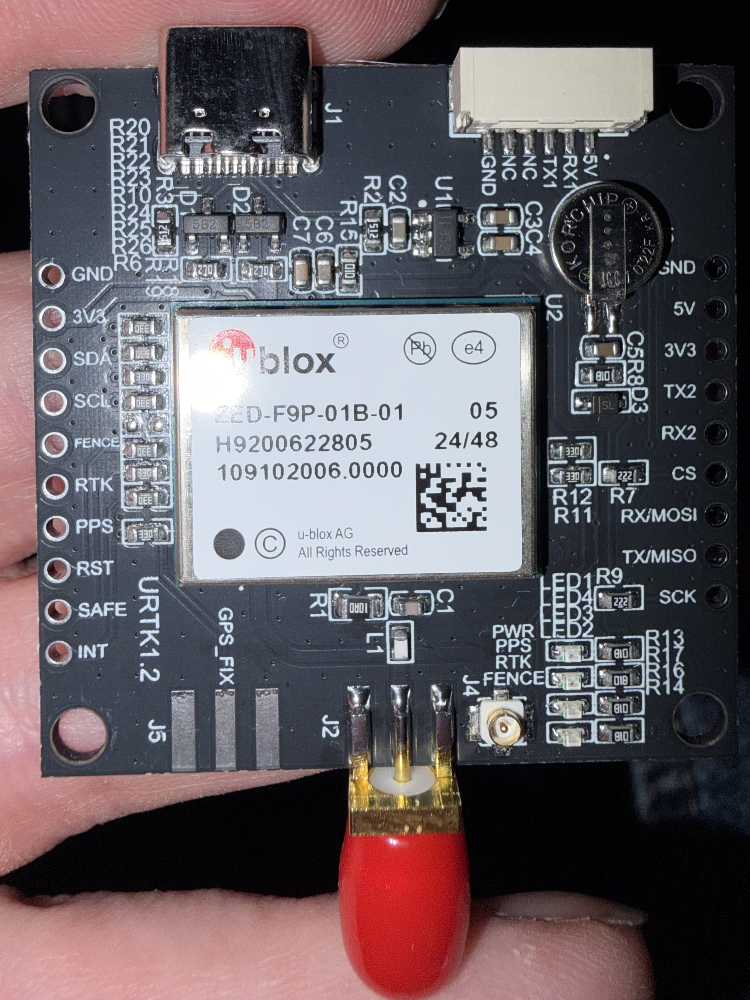
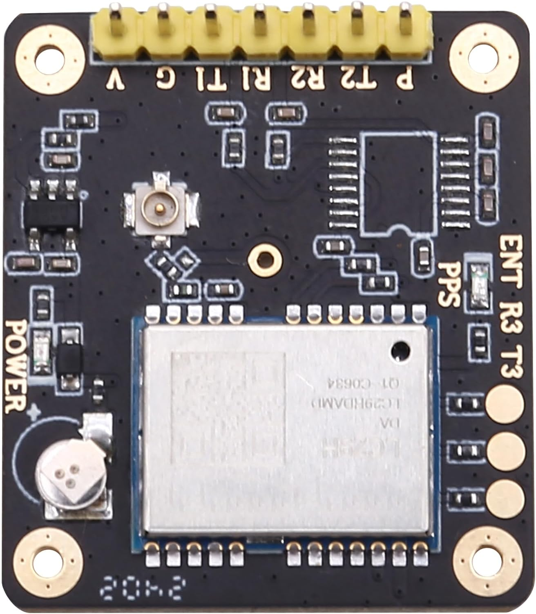

# ESP32 BLE GNSS RTK rover prototype

This Arduino prototype connects an ESP32 development board to a u-blox ZED-F9P or Quectel LC29H(DA) GNSS receiver. Two targets are supported: the ESP32-S3 N16R8 board and the ESP32-C3 SuperMini board. It uses BLE only, without Bluetooth Classic.

The BLE RX characteristic accepts correction bytes for the receiver. The BLE TX characteristic provides only receiver UART bytes. Status output uses the serial console and an optional OLED.

## Receiver boards

### ZED-F9P board

The supplied photo shows a ZED-F9P-01B-01 module on a board marked `URTK1.2`.



Use the white six-pin connector labeled `GND`, `NC`, `NC`, `TX1`, `RX1`, and `5V`. These labels identify the receiver's UART1 connection. The side header also exposes `TX2` and `RX2` for UART2. This setup does not use UART2.

### LC29H(DA) board

The LC29H(DA) photo shows a carrier with a seven-pin header and a small coaxial connector.



The header labels are `V`, `G`, `T1`, `R1`, `R2`, `T2`, and `P`, as shown in the photo.
The photo alone does not establish their functions, voltage ratings, or UART routing.
Confirm these details with the carrier supplier or schematic before connection.

## Wiring

Disconnect power before connecting wires. Identify each contact by its board label, not by cable color.

### ZED-F9P with ESP32-S3 (default target `esp32-s3`)

| ESP32-S3 | ZED-F9P board, white six-pin connector |
| --- | --- |
| GPIO16 (GNSS RX) | TX1 |
| GPIO17 (GNSS TX) | RX1 |
| GND | GND |
| No connection | NC, NC |

### ZED-F9P with ESP32-C3 SuperMini (target `esp32-c3`)

| ESP32-C3 | ZED-F9P board, white six-pin connector |
| --- | --- |
| GPIO4 (GNSS RX) | TX1 |
| GPIO5 (GNSS TX) | RX1 |
| GND | GND |
| No connection | NC, NC |

Connect TX to RX in each direction. The firmware uses ESP32 hardware UART1. The UART1 pin pair comes from the selected PlatformIO environment: RX on GPIO16 and TX on GPIO17 for the ESP32-S3 target, RX on GPIO4 and TX on GPIO5 for the ESP32-C3 target. ESP32 UART numbering is independent of the receiver's UART numbering. USB serial carries diagnostic output.

### LC29H(DA) wiring

Confirm which carrier contacts provide receiver TX and receiver RX before connecting them.
Confirm that the selected receiver UART accepts commands and RTCM and outputs NMEA at 115200 baud.

| Receiver signal | ESP32-S3 | ESP32-C3 SuperMini |
| --- | --- | --- |
| TX | GPIO16 (GNSS RX) | GPIO4 (GNSS RX) |
| RX | GPIO17 (GNSS TX) | GPIO5 (GNSS TX) |
| G (ground) | GND | GND |

Use 3.3 V UART logic. The carrier header's `V` contact is its power input. It accepts 5 V, but its full input voltage range is not confirmed.
Connect a suitable GNSS antenna after confirming the carrier's antenna and active-antenna requirements with the supplier.
The photo does not establish the functions of the other header contacts. Leave them unconnected unless their functions are confirmed.

### ZED-F9P power and antenna

- UART signals must use 3.3 V logic. Never connect 5 V to an ESP32 GPIO or a receiver UART pin.
- The connector's `5V` label refers to board power, not UART voltage. The bare ZED-F9P module requires a regulated supply below 5 V.
- Confirm the carrier board's input rating with the seller before supplying power through its `5V` pin.
- Alternatively, power the receiver board through its USB-C connector with an appropriate USB supply.
- Connect the ESP32 and receiver grounds even when each board has a separate supply.
- Do not connect multiple receiver power inputs together without confirming the board's power-path design.
- Connect a suitable multiband GNSS antenna to the board's antenna input. Confirm active-antenna voltage and current requirements with the board supplier.

The photo shows an SMA antenna connector at the bottom and a small coaxial connector labeled `J4`. Their routing and antenna-bias circuitry require the carrier schematic. Do not assume both connectors support simultaneous use.

### ESP32-C3 battery power plan

This plan uses one 18650 Li-ion cell, a TP4056-style charger with battery protection, and a regulator verified to output 3.3 V. Confirm the remaining ratings below before assembly. This is not a verified complete power system.

```text
  5 V USB supply
       |
  charger USB-C input
  +------------------+
  | charger          |
  | B+  B-  OUT+ OUT-|
  +--|---|----|----|-+
     |   |    |    |
  cell+  |    |    +-------------------+------ C3 GND
  cell- -+    |                        +------ receiver GND
              |                        |
              +---- switch ----+---- regulator VI
                               |       regulator GND ---- OUT- / common ground
                               |       regulator VO (3.3 V) ---- C3 3V3
                               |
                               +---- [optional 5 V boost] ---- LC29H(DA) V
                                     (see conditions below)
```

Connect the cell only to `B+` and `B-`. Connect the load to `OUT+` and `OUT-` so it uses the charger's protection circuit. The switch disconnects both load branches, not the charger or the cell.

The supplied charger product photo shows the USB-C connector at the top. In that view, its bottom pads read left to right: `OUT+`, `B+`, `B-`, `OUT-`. The top input pads are `+` on the left and `-` on the right. Check the labels on the actual board because other modules can differ.

The supplied regulator photo shows the label side with the pins pointing right. From top to bottom, the labels are `VO`, `GND`, `VI`. Connect `VI` to the switched charger output, `GND` to `OUT-`, and `VO` to the C3 `3V3` pin. Do not use the C3 `5V` pin for this supply.

The LC29H(DA) carrier has its own 3.3 V regulator. Do not connect its `V` input to the external 3.3 V regulator output. The ZED-F9P carrier also has its own 3.3 V regulator. Its input must exceed 3.3 V by enough to account for regulator dropout. Its exact input voltage range is unknown. Do not connect its power input to the external 3.3 V regulator output.

The switched `OUT+` supply is approximately the cell voltage, about 3.0–4.2 V, not boosted 5 V. For the LC29H(DA), connect switched `OUT+` to a suitable 5 V boost converter input. Connect its output to the carrier's `V` contact. The carrier accepts 5 V, but its maximum input voltage is not confirmed. Omit the boost only if the carrier's input range covers the full cell voltage range. Use a boost converter rated for the cell voltage range and receiver load. Confirm the ZED-F9P `5V` pin rating before using it.

The C3 uses GPIO4 for GNSS RX and GPIO5 for GNSS TX. If enabled, the OLED uses GPIO6 for SDA and GPIO7 for SCL. Connect the LC29H(DA) carrier's `G` contact and any boost converter ground to `OUT-`.

Before connecting the boards:

- Confirm the cell chemistry, charge voltage, permitted charge current, polarity, and protection requirements. Confirm the charger's actual charge current and protection functions.
- Confirm the regulator's input range, output current, dropout or conversion behavior, and stability across the cell voltage range. A verified 3.3 V output alone does not establish these ratings.
- Measure the regulator output and polarity without the C3 or receiver connected. Check the output again under the intended load.
- Do not assume the charger supports powering the load while charging. Use a verified power-path circuit or switch the load off during charging.
- Do not connect the C3 USB supply and external 3.3 V at the same time unless the board's power path is verified safe against backfeeding.

Battery voltage measurement would need a divider to keep the ADC input within its safe range. The current firmware does not measure battery voltage. Do not connect the cell directly to an ESP32 GPIO.

## Optional 64×48 I2C OLED

OLED support is disabled in all original environments. Append `-oled` to any environment name to enable it:

```sh
make build ENV=esp32-s3-oled
make build ENV=esp32-c3-oled
make build ENV=esp32-s3-lc29h-da-oled
make build ENV=esp32-c3-lc29h-da-oled
```

Use the same environment for upload and monitor. These environments add the Adafruit SSD1306 and GFX libraries.
The firmware assumes a 64×48 SSD1306 at I2C address `0x3C`, internal charge pump, and no separate reset wire.
It uses the library's default controller initialization and column/page addressing, without a module-specific offset.
Some 64×48 modules need different offsets or use another controller. Those modules are not covered by this configuration.

Disconnect power before connection. Use a module that supports 3.3 V power and 3.3 V I2C signals.
Check the module's pin labels and pull-up voltage. Do not use pull-ups to 5 V.

| OLED | ESP32-S3 | ESP32-C3 SuperMini |
| --- | --- | --- |
| VCC | 3V3 | 3V3 |
| GND | GND | GND |
| SDA | GPIO8 | GPIO6 |
| SCL | GPIO9 | GPIO7 |

These pins avoid the configured GNSS UART pins, USB pins, and boot strapping pins on each target.
They assume the board exposes these GPIOs without other peripherals attached. Check your board before connection.
Pin flags are in `platformio.ini`. The I2C address is `kOledAddress` in `include/config.h`.

The display updates about once per second. It shows the latest valid GGA quality and BLE connection state:

| Display | Meaning |
| --- | --- |
| `NO GGA` | No checksum-valid GGA with a valid quality field received since boot |
| `GGA STALE` | No valid GGA quality update for at least five seconds |
| `NO FIX` | GGA quality 0 |
| `GNSS` | GGA quality 1 |
| `DGPS` | GGA quality 2 |
| `RTK FIX` | GGA quality 4 |
| `RTK FLOAT` | GGA quality 5 |
| `OTHER FIX` | Another single-digit GGA quality, not interpreted as RTK |
| `BLE UP` / `BLE DOWN` | BLE connected / disconnected, not notification subscription or correction reception |

Checksum failures, malformed quality fields, and other NMEA messages do not refresh GGA status.
Freshness tracking does not depend on serial diagnostics. A new valid GGA replaces the stale indication.
The OLED does not confirm correction delivery or position accuracy. It adds no data to the BLE stream.

The firmware probes the display at startup. If it is absent, the firmware skips display updates and continues GNSS/BLE operation.
I2C operations use a five-millisecond driver timeout. Display transfers are synchronous and add loop latency, not a separate task.
If a later probe fails, updates stop until the ESP32 restarts. Hot-plug recovery is not supported.
OLED wiring, controller offsets, display appearance, and forwarding throughput with the display require hardware checks.

## ZED-F9P receiver configuration

The default ZED-F9P builds do not configure the receiver. Configure it through the receiver board's USB connection with u-blox u-center or another compatible configuration tool.

Factory UART1 settings are normally **38400 baud, 8N1**, with NMEA output and RTCM 3 input enabled. A seller or previous owner can change these settings. This firmware expects **38400 baud, 8N1** by default.

1. Connect to the receiver through USB and read its firmware version and current configuration.
2. Set receiver UART1 to 38400 baud, 8 data bits, no parity, and one stop bit.
3. Enable RTCM 3 input on UART1 (`CFG-UART1INPROT-RTCM3X`).
4. Enable NMEA output on UART1 (`CFG-UART1OUTPROT-NMEA`).
5. Enable the UART1 NMEA messages listed below.
6. Disable periodic UBX and RTCM output on UART1 to keep the rover's output stream NMEA-only.
7. Disable time mode (`CFG-TMODE-MODE = 0`) for rover use. Do not enable base-station survey-in or fixed-position mode.
8. Start with a 1 Hz navigation rate and a small NMEA message set to limit BLE traffic.
9. Save the configuration to supported persistent storage, not only RAM.
10. Restart the receiver and verify that the settings persist.

### UART1 NMEA messages

[SW Maps documents](https://aviyaantech.com/swmaps/) these NMEA sentence requirements:

| Sentences | SW Maps display | UART1 configuration |
| --- | --- | --- |
| GGA, RMC | Position and time | Enable both messages in the message-output settings |
| GSA, GSV | Satellite status and skyplot | Enable both messages in the message-output settings |
| GST | Latitude Error, Longitude Error, Horizontal Accuracy, and Vertical Accuracy | Set `CFG-MSGOUT-NMEA_ID_GST_UART1` to `1` |

The GST rate of `1` means output once per navigation cycle. Save these message settings with the rest of the receiver configuration.

If accuracy fields show `N/A`, verify `$GNGST` or `$GPGST` output on **UART1**, not only USB. USB output settings are separate. Reconnect SW Maps and check the accuracy fields under **GNSS Status**.

The bridge already forwards GST without a firmware change. Its periodic serial samples capture only part of the stream. A missing GST sentence in those samples does not prove that UART1 GST output is absent.

GST values describe receiver-estimated errors, not guaranteed real-world accuracy. A standalone GNSS fix can provide error estimates without RTK corrections.

### Baud rate, rover operation, and precision

Configuration names and tool menus depend on the receiver firmware. If you change the receiver's UART1 baud rate, change `kGnssBaud` in `include/gnss_receiver.h` to match. The serial console remains at 115200 baud. UART1 pin numbers come from the `GNSS_RX_PIN` and `GNSS_TX_PIN` build flags of each environment in `platformio.ini`; `include/config.h` keeps the ESP32-S3 pair as fallback defaults.

UART2 normally serves correction traffic and does not output NMEA by default. Connecting this bridge to `TX2`/`RX2` without receiver configuration will not provide the expected NMEA stream.

For RTK, supply compatible RTCM 3 corrections from an NTRIP service or base station. The correction stream must cover the constellations and signals used by the receiver. The ZED-F9P computes the RTK solution, not the ESP32.

For higher position precision in NMEA, consider `CFG-NMEA-HIGHPREC` after checking the client application's support. The status parser discards sentences longer than 127 characters. Raw UART bytes still pass to BLE.

References: [ZED-F9P-01B data sheet](https://content.u-blox.com/sites/default/files/documents/ZED-F9P-01B_DataSheet_UBX-17051259.pdf) and [ZED-F9P integration manual](https://content.u-blox.com/sites/default/files/ZED-F9P_IntegrationManual_UBX-18010802.pdf). Use the interface description that matches the installed receiver firmware.

## LC29H(DA) receiver configuration

Select `esp32-s3-lc29h-da` or `esp32-c3-lc29h-da` for the Quectel LC29H(DA). Other LC29H variants are not covered.
These builds use **115200 baud, 8N1**. They keep the selected ESP32 board's UART pins and BLE service unchanged.
Connect receiver TX to ESP32 GNSS RX, receiver RX to ESP32 GNSS TX, and connect both grounds.
Use 3.3 V UART logic. Check the LC29H(DA) carrier's power ratings and connector labels before connection.
The ZED-F9P power instructions and connector pinout do not describe the LC29H(DA) carrier.

On every ESP32 boot, the firmware waits 1200 ms after UART startup, then sends these command bodies in order:

```text
PQTMCFGRCVRMODE,W,1
PQTMCFGRTK,W,1,1
PQTMCFGPROT,W,1,1,00000005,00000005
PQTMCFGMSGRATE,W,GGA,1
PQTMCFGMSGRATE,W,RMC,1
PQTMCFGMSGRATE,W,GSA,1
PQTMCFGMSGRATE,W,GSV,1
PQTMCFGMSGRATE,W,VTG,0
PQTMCFGMSGRATE,W,GLL,0
PQTMCFGMSGRATE,W,ZDA,0
```

Each command uses `$body*XX\r\n` framing. `XX` is the two-digit hexadecimal XOR checksum of the body.
The firmware waits 250 ms between commands. BLE starts after this sequence, approximately 3.45 seconds after UART startup.
These commands match the supplied LC29H(DA) reference project. The firmware sends them again because they are not persisted.
There are no acknowledgment waits or retries. A short UART write stops setup and prints a console error, but BLE still starts.
The success log confirms writes only, not receiver acceptance. Power the receiver before resetting the ESP32.
After a receiver-only reset, reset the ESP32 to send the commands again.

This message set enables GGA, RMC, GSA, and GSV. It does not configure GST or promise SW Maps accuracy fields.
The bridge still forwards all receiver bytes, including command responses, without filtering.
Supply RTCM corrections through the BLE client. The firmware adds no Wi-Fi or NTRIP client.
LC29H(DA) command acceptance, RTK operation, and BLE interoperability require hardware checks.

## Build and host tests

Install Make and PlatformIO Core. Host tests also require a C++17 compiler. The `esp32-s3` environment targets an ESP32-S3 N16R8 board with 16 MB flash and 8 MB octal PSRAM. The `esp32-c3` environment targets an ESP32-C3 SuperMini board (the `esp32-c3-devkitm-1` board definition, 4 MB flash, no PSRAM).

`make` defaults to `make build` for the ESP32-S3 target. Select the target with `ENV`:

```sh
make test
make build
make upload
make monitor

make build ENV=esp32-c3
make upload ENV=esp32-c3
make monitor ENV=esp32-c3

make build ENV=esp32-s3-lc29h-da
make upload ENV=esp32-s3-lc29h-da
make monitor ENV=esp32-s3-lc29h-da

make build ENV=esp32-c3-lc29h-da
make upload ENV=esp32-c3-lc29h-da
make monitor ENV=esp32-c3-lc29h-da
```

The monitor uses the 115200 baud setting from `platformio.ini`.
The original `esp32-s3` and `esp32-c3` environments still select ZED-F9P at 38400 baud without startup commands.
Custom environments can set `-DGNSS_RECEIVER=GNSS_RECEIVER_LC29H_DA`. Unsupported receiver values fail compilation.

### Upload and console ports

ESP32-S3: use the board's USB-to-UART connector for upload and diagnostic output. The receiver's USB port is separate.

ESP32-C3 SuperMini: the board exposes only its native USB connection, without a USB-to-UART bridge. The `esp32-c3` build enables the USB CDC console (`ARDUINO_USB_CDC_ON_BOOT=1`, `ARDUINO_USB_MODE=1`), so `Serial` output appears on the board's USB port at 115200 baud. Upload and monitor through that same port. Many SuperMini clones do not enter the bootloader automatically; if the upload times out, press the `BOOT`/`GPIO9` button while resetting or plugging in the board. The CDC port disappears while the board is in the bootloader or resetting, so the port name can change between phases. These port behaviors are not verified on hardware.

If multiple serial devices appear, use PlatformIO directly to select the ESP32 port:

```sh
pio run -e esp32-s3 -t upload --upload-port /path/to/esp32-port
pio device monitor -e esp32-s3 --port /path/to/esp32-port
pio run -e esp32-c3 -t upload --upload-port /path/to/esp32-port
pio device monitor -e esp32-c3 --port /path/to/esp32-port
```

The monitor shows startup diagnostics, including the free-heap measurement at boot. Run host-only protocol tests with:

```sh
sh test/host/run.sh
```

The project pins PlatformIO's Espressif32 platform to `~8.0.0`; BLE uses the Arduino ESP32 core's bundled `BLEDevice` GATT API. Host tests cover NMEA checksum/fix parsing, BLE UART batching, and binary RTCM byte-preserving forwarding, including short writes. Status tests cover quality labels, malformed input, freshness boundaries, timer wraparound, and BLE labels. Receiver tests check baud selection, command bytes, checksums, delays, repeated boots, and write failure without receiver responses. The host tests do not compile or emulate the ESP32 BLE stack or OLED hardware.

## Serial diagnostics

Serial diagnostics are enabled by default through `kSerialDebug` in `include/config.h`.

1. Upload the firmware with `make upload` or `make upload ENV=esp32-c3`.
2. Open `pio device monitor -b 115200` on the ESP32's console port: the USB-to-UART port on the ESP32-S3, the native USB CDC port on the ESP32-C3 SuperMini.
3. Press the ESP32 reset button to see the startup baud rate and GPIO assignments.
4. Connect SW Maps and capture several seconds of console output.

Each second, the console shows BLE connection state, GGA fix quality, sentence counts, checksum errors, and correction bytes. Additional fields show:

| Field | Meaning |
| --- | --- |
| `gnss_rx_bytes` | Total bytes read from the receiver UART since boot |
| `nmea` | Total complete NMEA sentences with valid checksums |
| `ble_nmea_notify_calls` | NMEA chunk notification attempts, not byte counts, confirmed delivery, or client subscription |
| `last_rx_age_ms` | Time since the last UART byte |
| `sample_bytes` | Bytes captured for this sample, up to 64 per reporting interval |

`[gnss hex]` shows the sample as hexadecimal bytes. `[gnss text]` shows the same bytes, with dots for nonprintable bytes. Samples are partial data, not necessarily complete sentences. The console does not echo the full UART stream.

- If `gnss_rx_bytes` stays zero, check receiver power, shared ground, and receiver TX to GNSS RX wiring (GPIO16 on ESP32-S3, GPIO4 on ESP32-C3).
- If bytes arrive without valid NMEA, compare the receiver's UART1 baud rate with the startup log.
- If the text sample is unreadable, check baud rate and signal levels. Binary UBX output can also produce unreadable text.
- If `nmea` increases but `gga` stays zero, enable GGA output on receiver UART1.
- If `gga` increases with `fix=0`, check the antenna and sky view.
- If valid NMEA and notification attempts increase, check SW Maps' TX characteristic subscription and BLE compatibility.
- If `last_rx_age_ms` increases continuously, the receiver stream has stopped. The displayed fix value can be stale.

Set `kSerialDebug` to `false` and rebuild to disable periodic console diagnostics. The startup free-heap message remains enabled. Diagnostics do not change the BLE payload format or prove that SW Maps accepts it.

## GATT protocol

Service UUID: `6e400001-b5a3-f393-e0a9-e50e24dcca9e` (Nordic-UART-style UUIDs).

* RX `6e400002-b5a3-f393-e0a9-e50e24dcca9e`: write or write-without-response. Each write payload is forwarded unchanged to GNSS UART; payloads are treated as opaque binary (not UTF-8 or NMEA).
* TX `6e400003-b5a3-f393-e0a9-e50e24dcca9e`: notifications/read. Receiver UART bytes use chunks of up to 20 bytes, compatible with the default ATT MTU of 23 bytes. Full chunks send immediately. After each UART drain, a partial chunk sends if at least 20 ms have elapsed since the previous notification. Concatenate notifications to reconstruct the stream, including original CR/LF sentence endings. A notification can contain part of a sentence or cross a sentence boundary. Reads return the latest chunk, not a complete sentence or history. No diagnostic status text is inserted into this stream.

Use the configuration for [ZED-F9P](#zed-f9p-receiver-configuration) or [LC29H(DA)](#lc29hda-receiver-configuration) above. The bridge does not filter binary output or change talker IDs. It does not replay bytes received while disconnected or guarantee notification delivery. Batching reduces notification overhead, but SW Maps interoperability still requires a hardware check.

## SW Maps setup checklist

1. Pair/connect to `GNSS-RTK-Rover` using SW Maps' BLE GNSS/external receiver workflow (exact menu names vary by app version).
2. Select the BLE device and configure NMEA input from the TX characteristic if SW Maps offers characteristic selection.
3. Configure the correction source/NTRIP client in the app and select the RX characteristic as correction output if supported.
4. Confirm NMEA updates and RTK status on the receiver; compare the receiver's own status output with the firmware status.

For satellite and accuracy displays, use the NMEA message settings in [receiver configuration](#zed-f9p-receiver-configuration).

The user confirmed valid SW Maps positioning with the batched NMEA stream. Accuracy fields, NTRIP corrections, and RTK operation still require hardware checks.

## Receiver checks and limitations

Check the following with a BLE client and the receiver's own diagnostics:

| Observation | Check |
| --- | --- |
| No NMEA data | Receiver power, shared ground, crossed TX/RX wires, UART1 baud rate, and UART1 NMEA message settings |
| Corrupt NMEA or checksum errors | Baud rate, logic voltage, wiring, and serial signal quality |
| `gga` increases, but `fix=0` | Antenna connection, sky view, and receiver fix status |
| Standalone fix, but no RTK | Correction source, RTCM compatibility, correction age, and UART1 RTCM input settings |
| `rtcm_bytes` increases, but no RTK | Receiver diagnostics for accepted RTCM messages and the resulting solution |

GGA fix quality normally reports `1` for standalone GNSS, `2` for differential GNSS, `4` for RTK fixed, and `5` for RTK float. Serial diagnostics report the last parsed GGA value, which can be stale. The optional OLED marks GGA status stale after five seconds without a valid update.

`rtcm_bytes` counts bytes accepted into the ESP32 correction buffer. It does not confirm delivery to the receiver or successful RTCM decoding. The firmware does not validate RTCM framing or guarantee RTK operation.

Verified locally: the ESP32-S3 and ESP32-C3 target builds compile, and host protocol tests pass. Neither board has been tested against this receiver hardware, and hardware checks remain open for the receiver board, BLE throughput, SW Maps, and RTCM acceptance. The ESP32-C3 target is built from the shared sources with the wiring above; it is unverified on a SuperMini board. Serial output provides the boot-time free-heap value, but no hardware measurement is recorded here.
