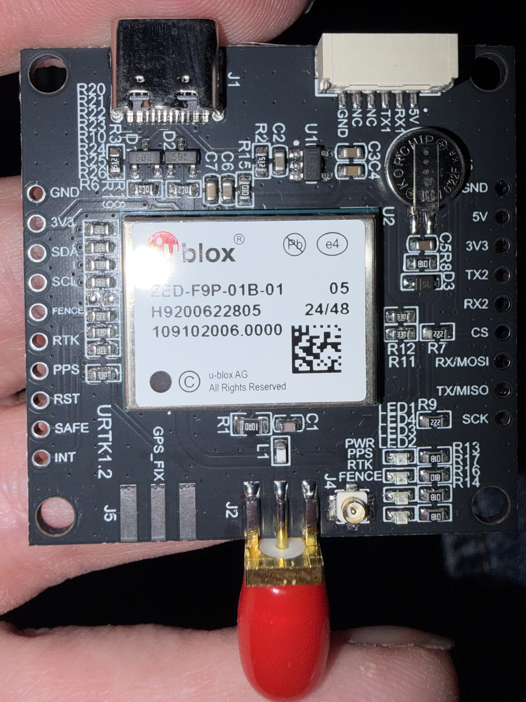

# ESP32 BLE GNSS RTK rover prototype

This Arduino prototype connects an ESP32-S3 N16R8 development board to a u-blox ZED-F9P GNSS receiver. It uses BLE only, without Bluetooth Classic.

The BLE RX characteristic accepts correction bytes for the receiver. The BLE TX characteristic provides only receiver UART bytes. Status output uses the serial console.

## Receiver board

The supplied photo shows a ZED-F9P-01B-01 module on a board marked `URTK1.2`.



Use the white six-pin connector labeled `GND`, `NC`, `NC`, `TX1`, `RX1`, and `5V`. These labels identify the receiver's UART1 connection. The side header also exposes `TX2` and `RX2` for UART2. This setup does not use UART2.

## Wiring

Disconnect power before connecting wires. Identify each contact by its board label, not by cable color.

| ESP32-S3 | ZED-F9P board, white six-pin connector |
| --- | --- |
| GPIO16 (GNSS RX) | TX1 |
| GPIO17 (GNSS TX) | RX1 |
| GND | GND |
| No connection | NC, NC |

Connect TX to RX in each direction. The firmware uses ESP32 hardware UART1, with RX on GPIO16 and TX on GPIO17. ESP32 UART numbering is independent of the receiver's UART numbering. USB serial carries diagnostic output.

### Power and antenna

- UART signals must use 3.3 V logic. Never connect 5 V to an ESP32 GPIO or a receiver UART pin.
- The connector's `5V` label refers to board power, not UART voltage. The bare ZED-F9P module requires a regulated supply below 5 V.
- Confirm the carrier board's input rating and regulator arrangement with the seller before supplying power through its `5V` pin.
- Alternatively, power the receiver board through its USB-C connector with an appropriate USB supply.
- Connect the ESP32 and receiver grounds even when each board has a separate supply.
- Do not connect multiple receiver power inputs together without confirming the board's power-path design.
- Connect a suitable multiband GNSS antenna to the board's antenna input. Confirm active-antenna voltage and current requirements with the board supplier.

The photo shows an SMA antenna connector at the bottom and a small coaxial connector labeled `J4`. Their routing and antenna-bias circuitry require the carrier schematic. Do not assume both connectors support simultaneous use.

## ZED-F9P receiver setup

The firmware does not configure the receiver. Configure it through the receiver board's USB connection with u-blox u-center or another compatible configuration tool.

Factory UART1 settings are normally **38400 baud, 8N1**, with NMEA output and RTCM 3 input enabled. A seller or previous owner can change these settings. This firmware expects **38400 baud, 8N1** by default.

1. Connect to the receiver through USB and read its firmware version and current configuration.
2. Set receiver UART1 to 38400 baud, 8 data bits, no parity, and one stop bit.
3. Enable RTCM 3 input on UART1 (`CFG-UART1INPROT-RTCM3X`).
4. Enable NMEA output on UART1 (`CFG-UART1OUTPROT-NMEA`).
5. Enable GGA and RMC messages on UART1 in the message-output settings.
6. Disable periodic UBX and RTCM output on UART1 to keep the rover's output stream NMEA-only.
7. Disable time mode (`CFG-TMODE-MODE = 0`) for rover use. Do not enable base-station survey-in or fixed-position mode.
8. Start with a 1 Hz navigation rate and a small NMEA message set to limit BLE traffic.
9. Save the configuration to supported persistent storage, not only RAM.
10. Restart the receiver and verify that the settings persist.

Configuration names and tool menus depend on the receiver firmware. If you change the receiver's UART1 baud rate, change `kGnssBaud` in `include/config.h` to match. Pin constants are in the same file. The serial console remains at 115200 baud.

UART2 normally serves correction traffic and does not output NMEA by default. Connecting this bridge to `TX2`/`RX2` without receiver configuration will not provide the expected NMEA stream.

For RTK, supply compatible RTCM 3 corrections from an NTRIP service or base station. The correction stream must cover the constellations and signals used by the receiver. The ZED-F9P computes the RTK solution, not the ESP32.

For higher position precision in NMEA, consider `CFG-NMEA-HIGHPREC` after checking the client application's support. The status parser discards sentences longer than 127 characters. Raw UART bytes still pass to BLE.

References: [ZED-F9P-01B data sheet](https://content.u-blox.com/sites/default/files/documents/ZED-F9P-01B_DataSheet_UBX-17051259.pdf) and [ZED-F9P integration manual](https://content.u-blox.com/sites/default/files/ZED-F9P_IntegrationManual_UBX-18010802.pdf). Use the interface description that matches the installed receiver firmware.

## Build and host tests

Install PlatformIO Core. The `esp32-s3` environment targets an ESP32-S3 N16R8 board with 16 MB flash and 8 MB octal PSRAM.

```sh
pio run -e esp32-s3
pio run -e esp32-s3 -t upload
pio device monitor -b 115200
```

Use the ESP32 board's USB-to-UART connector for upload and diagnostic output. If multiple serial devices appear, select the ESP32 port with `--upload-port` or the monitor's `--port` option. The receiver's USB port is separate.

The monitor shows startup diagnostics, including the free-heap measurement at boot. Run host-only protocol tests with:

```sh
sh test/host/run.sh
```

The project pins PlatformIO's Espressif32 platform to `~8.0.0`; BLE uses the Arduino ESP32 core's bundled `BLEDevice` GATT API. Host tests cover NMEA checksum/fix parsing, BLE UART batching, and binary RTCM byte-preserving forwarding, including short writes. The host tests do not compile or emulate the ESP32 BLE stack.

## Serial diagnostics

Serial diagnostics are enabled by default through `kSerialDebug` in `include/config.h`.

1. Upload the firmware with `pio run -e esp32-s3 -t upload`.
2. Open `pio device monitor -b 115200` on the ESP32's USB-to-UART port.
3. Press the ESP32 reset button to see the startup baud rate and GPIO assignments.
4. Connect SW Maps and capture several seconds of console output.

Each second, the console shows BLE connection state, GGA fix quality, sentence counts, checksum errors, and correction bytes. Additional fields show:

| Field | Meaning |
| --- | --- |
| `gnss_rx_bytes` | Total bytes read from the receiver UART since boot |
| `nmea` | Total complete NMEA sentences with valid checksums |
| `ble_nmea_notify_calls` | NMEA chunk notification attempts, not byte counts, confirmed delivery, or client subscription |
| `last_rx_age_ms` | Time since the last UART byte |
| `sample_bytes` | Bytes captured for this sample, up to 64 per reporting interval |

`[gnss hex]` shows the sample as hexadecimal bytes. `[gnss text]` shows the same bytes, with dots for nonprintable bytes. Samples are partial data, not necessarily complete sentences. The console does not echo the full UART stream.

- If `gnss_rx_bytes` stays zero, check receiver power, shared ground, and `TX1` to GPIO16 wiring.
- If bytes arrive without valid NMEA, compare the receiver's UART1 baud rate with the startup log.
- If the text sample is unreadable, check baud rate and signal levels. Binary UBX output can also produce unreadable text.
- If `nmea` increases but `gga` stays zero, enable GGA output on receiver UART1.
- If `gga` increases with `fix=0`, check the antenna and sky view.
- If valid NMEA and notification attempts increase, check SW Maps' TX characteristic subscription and BLE compatibility.
- If `last_rx_age_ms` increases continuously, the receiver stream has stopped. The displayed fix value can be stale.

Set `kSerialDebug` to `false` and rebuild to disable periodic console diagnostics. The startup free-heap message remains enabled. Diagnostics do not change the BLE payload format or prove that SW Maps accepts it.

## GATT protocol

Service UUID: `6e400001-b5a3-f393-e0a9-e50e24dcca9e` (Nordic-UART-style UUIDs).

* RX `6e400002-b5a3-f393-e0a9-e50e24dcca9e`: write or write-without-response. Each write payload is forwarded unchanged to GNSS UART; payloads are treated as opaque binary (not UTF-8 or NMEA).
* TX `6e400003-b5a3-f393-e0a9-e50e24dcca9e`: notifications/read. Receiver UART bytes use chunks of up to 20 bytes, compatible with the default ATT MTU of 23 bytes. Full chunks send immediately. After each UART drain, a partial chunk sends if at least 20 ms have elapsed since the previous notification. Concatenate notifications to reconstruct the stream, including original CR/LF sentence endings. A notification can contain part of a sentence or cross a sentence boundary. Reads return the latest chunk, not a complete sentence or history. No diagnostic status text is inserted into this stream.

Configure receiver UART1 output for NMEA only. The bridge does not filter binary output or change talker IDs. It does not replay bytes received while disconnected or guarantee notification delivery. Batching reduces notification overhead, but SW Maps interoperability still requires a hardware check.

## SW Maps setup checklist

1. Pair/connect to `GNSS-RTK-Rover` using SW Maps' BLE GNSS/external receiver workflow (exact menu names vary by app version).
2. Select the BLE device and configure NMEA input from the TX characteristic if SW Maps offers characteristic selection.
3. Configure the correction source/NTRIP client in the app and select the RX characteristic as correction output if supported.
4. Confirm NMEA updates and RTK status on the receiver; compare the receiver's own status output with the firmware status.

The GATT service layout is implemented in source, but SW Maps interoperability and its ability to select the two characteristics have not been verified on hardware. Some app flows expect a standard BLE GNSS profile rather than a generic UART service.

## Receiver checks and limitations

Check the following with a BLE client and the receiver's own diagnostics:

| Observation | Check |
| --- | --- |
| No NMEA data | Receiver power, shared ground, crossed TX/RX wires, UART1 baud rate, and UART1 NMEA message settings |
| Corrupt NMEA or checksum errors | Baud rate, logic voltage, wiring, and serial signal quality |
| `gga` increases, but `fix=0` | Antenna connection, sky view, and receiver fix status |
| Standalone fix, but no RTK | Correction source, RTCM compatibility, correction age, and UART1 RTCM input settings |
| `rtcm_bytes` increases, but no RTK | Receiver diagnostics for accepted RTCM messages and the resulting solution |

GGA fix quality normally reports `1` for standalone GNSS, `2` for differential GNSS, `4` for RTK fixed, and `5` for RTK float. The firmware reports the last parsed GGA value. It does not detect a stale fix after NMEA stops.

`rtcm_bytes` counts bytes accepted into the ESP32 correction buffer. It does not confirm delivery to the receiver or successful RTCM decoding. The firmware does not validate RTCM framing or guarantee RTK operation.

Verified locally: the ESP32-S3 target build and host protocol tests. Hardware checks remain open for this receiver board, BLE throughput, SW Maps, and RTCM acceptance. Serial output provides the boot-time free-heap value, but no hardware measurement is recorded here.
