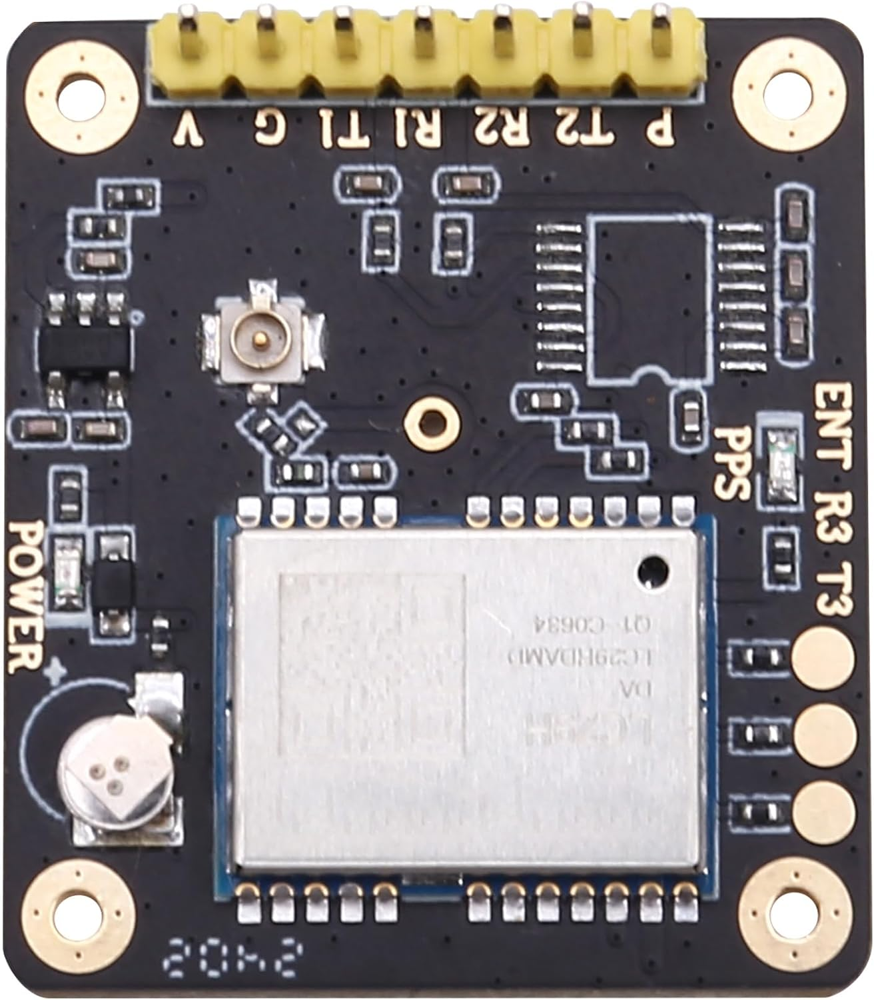
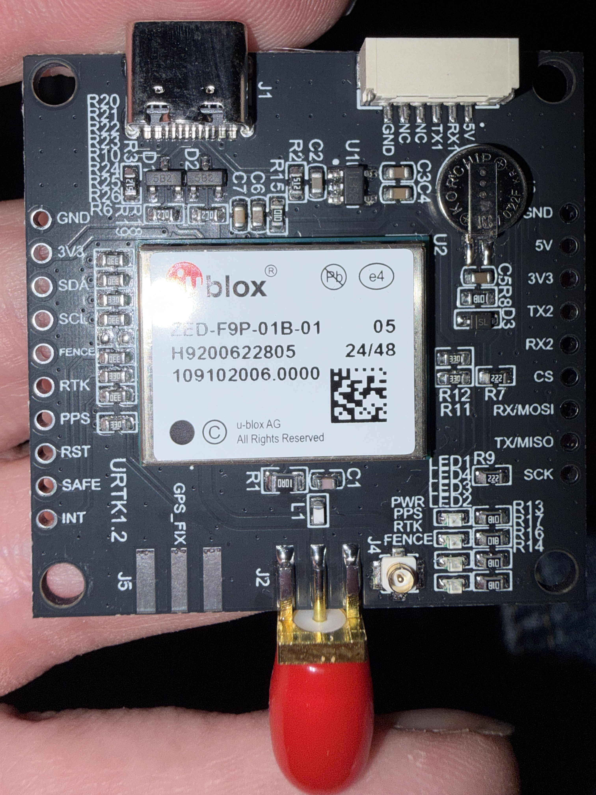

# Hardware and wiring

[Back to README](../README.md)

The final hardware target is the ESP32-C3 SuperMini with an LC29H(DA) receiver and a [64×48 I2C OLED](display.md).
The project also supports an ESP32-S3 N16R8 and a u-blox ZED-F9P.
All targets use BLE, without Bluetooth Classic. USB serial carries diagnostic output.

## Receiver boards

### LC29H(DA)

The supplied photo shows a carrier with a seven-pin header and a small coaxial connector.

The header labels are `V`, `G`, `T1`, `R1`, `R2`, `T2`, and `P`.
The photo alone does not establish their functions, voltage ratings, or UART routing.
Confirm these details with the carrier supplier or schematic before connection.

### ZED-F9P

The supplied photo shows a ZED-F9P-01B-01 module on a board marked `URTK1.2`.

Use the white six-pin connector labeled `GND`, `NC`, `NC`, `TX1`, `RX1`, and `5V`.
These labels identify the receiver's UART1 connection. The side header also exposes `TX2` and `RX2` for UART2.
This setup does not use UART2.

## Wiring

Disconnect power before connecting wires. Identify each contact by its board label, not by cable color.
Connect TX to RX in each direction. The firmware uses ESP32 hardware UART1.
ESP32 UART numbering is independent of the receiver's UART numbering.

### LC29H(DA)

Confirm which carrier contacts provide receiver TX and receiver RX before connecting them.
The selected receiver UART must accept commands and RTCM and output NMEA at 115200 baud.

| Receiver signal | ESP32-C3 SuperMini | ESP32-S3 |
| --- | --- | --- |
| TX | GPIO4 (GNSS RX) | GPIO16 (GNSS RX) |
| RX | GPIO5 (GNSS TX) | GPIO17 (GNSS TX) |
| G (ground) | GND | GND |

Use 3.3 V UART logic. The carrier header's `V` contact is its power input.
It accepts 5 V, but its full input voltage range is not confirmed.
The carrier has its own 3.3 V regulator. Do not connect its `V` input to an external 3.3 V regulator output.
Connect a suitable GNSS antenna after confirming the carrier's antenna and active-antenna requirements with the supplier.
The photo does not establish the functions of the other header contacts. Leave them unconnected unless their functions are confirmed.

The ESP32 TX connection must reach the receiver's command RX input, not a different UART input.
Incorrect wiring can allow position output while preventing configuration and corrections from reaching the receiver.
Check any carrier USB/UART switches as well.

### ZED-F9P

| White six-pin connector | ESP32-C3 (`esp32-c3`) | ESP32-S3 (`esp32-s3`, current default) |
| --- | --- | --- |
| TX1 | GPIO4 (GNSS RX) | GPIO16 (GNSS RX) |
| RX1 | GPIO5 (GNSS TX) | GPIO17 (GNSS TX) |
| GND | GND | GND |
| NC, NC | No connection | No connection |

The UART pin pair comes from the selected [PlatformIO environment](development.md).

## ZED-F9P power and antenna

- UART signals must use 3.3 V logic. Never connect 5 V to an ESP32 GPIO or a receiver UART pin.
- The connector's `5V` label refers to board power, not UART voltage. The bare ZED-F9P module requires a regulated supply below 5 V.
- Confirm the carrier board's input rating with the seller before supplying power through its `5V` pin.
- Alternatively, power the receiver board through its USB-C connector with an appropriate USB supply.
- Connect the ESP32 and receiver grounds even when each board has a separate supply.
- Do not connect multiple receiver power inputs together without confirming the board's power-path design.
- Connect a suitable multiband GNSS antenna to the board's antenna input. Confirm active-antenna voltage and current requirements with the board supplier.

The photo shows an SMA antenna connector at the bottom and a small coaxial connector labeled `J4`.
Their routing and antenna-bias circuitry require the carrier schematic. Do not assume both connectors support simultaneous use.

The ZED-F9P carrier has its own 3.3 V regulator. Its input must exceed 3.3 V by enough to account for regulator dropout.
Its exact input voltage range is unknown. Do not connect its power input to an external 3.3 V regulator output.

See the separate [battery power plan](battery-power.md) and [receiver configuration](receivers.md).
